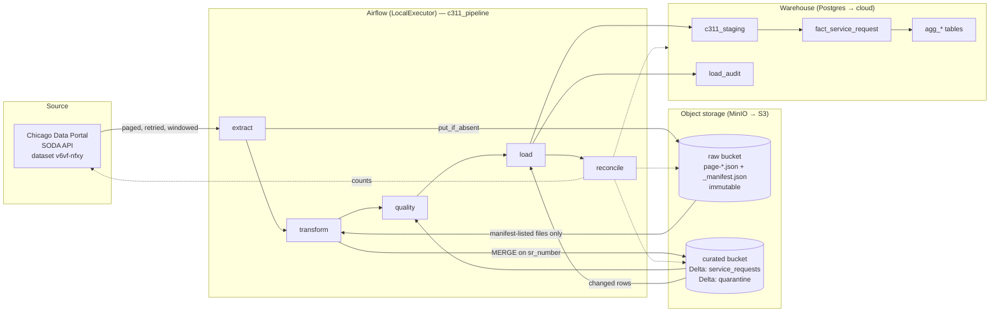

# Architecture

> Status: **design only**. The diagram describes the intended system; nothing here has been run
> end-to-end yet. Update this banner when that changes.

## Layers and what each guarantees

| Layer | Contents | Guarantee | Mutable? |
|---|---|---|---|
| Raw | Byte-exact API responses, one file per page, plus `_manifest.json` per run | Faithful record of what the source said, when | Never (append-only) |
| Curated | Typed, deduplicated Delta table (one row per `sr_number`) + quarantine table | Unique key, typed columns, lineage columns | Via idempotent `MERGE` only |
| Warehouse | Fact table + aggregates in Postgres | Query-ready; rebuilt deterministically from curated | Via one transaction per load |

## Boundaries (what may depend on what)

- `ingestion/` knows HTTP and `ObjectStore`. It does **not** know Spark, Delta or Airflow.
- `transform/` knows Spark/Delta. It does **not** make HTTP calls or know Airflow.
- `warehouse/` knows SQL via the `Warehouse` Protocol; Postgres specifics live in `postgres.py` and `sql/`.
- `dags/` only wires functions together and passes small values. No business logic.
- Only `config.py` reads the environment.

## Local → cloud mapping (later extension)

| Local | Cloud |
|---|---|
| MinIO | AWS S3 (unset `S3_ENDPOINT_URL`) |
| Postgres warehouse | Redshift / Snowflake / BigQuery (new `Warehouse` implementation + dialect SQL) |
| Spark local mode in Airflow image | EMR / Databricks / Glue (replace `spark_session.py`) |
| docker-compose Airflow | MWAA / Astronomer / Kubernetes |

Not in scope for v1: cloud deployment, advanced monitoring (Prometheus/Grafana), Delta Change Data Feed, CDC.
